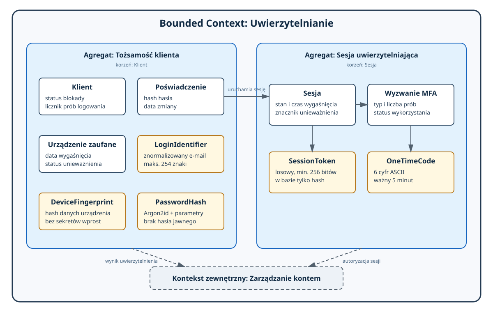

# Model domeny uwierzytelniania bankowego

## Krótki opis

Model obejmuje fragment systemu bankowego odpowiedzialny za bezpieczne
uwierzytelnianie klienta i zarządzanie jego sesją. Granicą kontekstu jest
obszar tożsamości, poświadczeń, dodatkowego uwierzytelnienia oraz urządzeń
zaufanych; saldo i operacje finansowe należą do innych kontekstów. Agregat
`Tożsamość klienta` chroni dane potrzebne do logowania, a agregat `Sesja
uwierzytelniająca` kontroluje dostęp po pomyślnym uwierzytelnieniu. Diagram
pokazuje encje, obiekty wartości i najważniejsze zależności między nimi.

## Bounded Context: Uwierzytelnianie

Kontekst udostępnia operacje `Zarejestruj tożsamość`, `Uwierzytelnij`,
`Potwierdź MFA`, `Unieważnij sesję` i `Zaufaj urządzeniu`. Do kontekstu
`Zarządzanie kontem` przekazywany jest wyłącznie wynik uwierzytelnienia oraz
identyfikator klienta. Kontekst nie przechowuje haseł w postaci jawnej i nie
wykonuje operacji na środkach pieniężnych.

## Agregaty i encje

| Element | Rodzaj | Odpowiedzialność i najważniejsze reguły |
|---|---|---|
| **Tożsamość klienta** | agregat, którego korzeniem jest encja **Klient** | Łączy identyfikator logowania, poświadczenia, status blokady i urządzenia zaufane. Po pięciu nieudanych próbach logowania tożsamość zostaje czasowo zablokowana. |
| **Poświadczenie** | encja wewnątrz agregatu `Tożsamość klienta` | Przechowuje wyłącznie hash hasła, algorytm i datę zmiany. Zmiana hasła unieważnia aktywne sesje. |
| **Urządzenie zaufane** | encja wewnątrz agregatu `Tożsamość klienta` | Reprezentuje urządzenie dopuszczone do pominięcia wybranych kroków MFA. Zaufanie wygasa po 90 dniach lub po ręcznym unieważnieniu. |
| **Sesja uwierzytelniająca** | agregat i encja korzeniowa | Przechowuje stan sesji, czas wygaśnięcia i znacznik unieważnienia. Sesja jest ważna maksymalnie 15 minut bezczynności i 8 godzin łącznie. |
| **Wyzwanie MFA** | encja wewnątrz agregatu `Sesja uwierzytelniająca` | Obsługuje jednorazowy kod lub potwierdzenie zaufanego urządzenia. Kod można sprawdzić najwyżej trzy razy i wykorzystać tylko raz. |

## Obiekty wartości i założenia

| Obiekt wartości | Format i ograniczenia |
|---|---|
| `LoginIdentifier` | Adres e-mail w formacie zgodnym z RFC 5322, zapisany małymi literami; maksymalnie 254 znaki. |
| `PasswordHash` | Hash Argon2id z parametrami zapisanymi razem z wynikiem; jawne hasło nie jest częścią modelu ani logów. |
| `OneTimeCode` | Sześć cyfr ASCII, ważne przez 5 minut; porównanie odbywa się w sposób odporny na ataki czasowe. |
| `SessionToken` | Losowy token o długości co najmniej 256 bitów; w bazie przechowywany jest wyłącznie jego hash. |
| `DeviceFingerprint` | Hash danych urządzenia; nie zawiera bezpośrednio numeru seryjnego ani innych danych osobowych. |

Przyjęto, że klient ma dokładnie jeden aktywny profil tożsamości dla danego
identyfikatora logowania, a wszystkie czasy są zapisywane w UTC. Nieudane
logowania nie ujawniają, czy dany identyfikator istnieje. Zdarzenia
`Uwierzytelnienie zakończone`, `Sesja unieważniona` i `MFA zakończone`
mogą być publikowane do innych kontekstów, ale nie przekazują sekretów.

